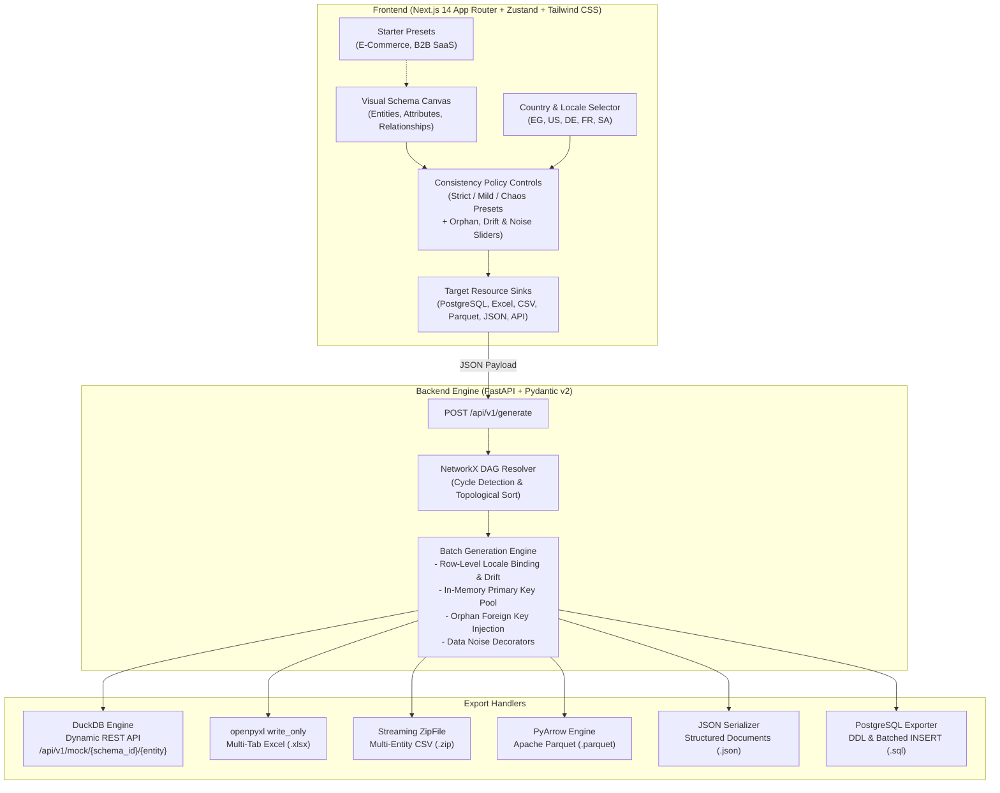

# Extensible Synthetic Data Generation Platform

A production-ready, full-stack synthetic data platform designed to build relational schemas, resolve topological foreign-key dependencies, enforce cultural and geographic localization, inject controlled data anomalies for ETL stress testing, and export datasets across **6 target resource sinks**:
1. 🐘 **PostgreSQL**: DDL and batched `INSERT` statements in topological dependency order.
2. 📊 **Excel Workbook**: Multi-tab `.xlsx` files powered by `openpyxl` with constant-memory streaming.
3. 📁 **CSV Archive**: Zipped collection of per-entity `.csv` files.
4. 📦 **Apache Parquet**: Snappy-compressed columnar analytical datasets.
5. 🏷️ **JSON Documents**: Formatted hierarchical document payloads.
6. ⚡ **Dynamic Mock REST API**: DuckDB-backed analytical endpoints with SQL-native `LIMIT`/`OFFSET` pagination.

---

## Architecture Overview



---

## Core Capabilities

### 1. Topological Graph Resolution (NetworkX)
- Automatically computes topological execution order using NetworkX so parent entities always generate before child entities.
- Rejects circular dependencies (`A ⇄ B`) in real time, surfacing the exact cyclical diagnostic path.
- Resolves intra-entity self-referential keys (e.g., `employees.manager_id ➔ employees.id`) via sequential two-pass emission.

### 2. Multi-Country Localization & Row-Level Binding
- Supports multiple countries: Egypt (`ar_EG`), United States (`en_US`), Germany (`de_DE`), France (`fr_FR`), Saudi Arabia (`ar_SA`).
- **Row-Level Locale Binding**: Each generated record binds to a single country locale, ensuring names, telephone formats, and street addresses match culturally and geographically within that row.
- **Cascading Fallback**: Gracefully falls back to `en_US` with structured warnings if a regional provider is absent.

### 3. Configurable Consistency & Anomaly Injection
- **Preset Modes**: `Strict` (100% clean), `Mild Inconsistency` (5% anomalies), and `Chaos / Stress Test` (25% anomalies).
- **Orphan Key Injection (`orphan_rate`)**: Injects non-existent parent IDs ($\ge 999000$) to stress-test `LEFT JOIN` and orphan-detection ETL pipelines.
- **Locale Drift (`locale_drift_rate`)**: Cross-pollinates country attributes within a controllable percentage of rows.
- **Data Noise (`noise_rate`)**: Simulates dirty real-world data with untrimmed whitespace (`" John "`), sentinel null representations (`"N/A"`, `"-"`, `""`), and format corruptions.
- **Duplicate Injection (`duplicate_rate`)**: Clones existing records to test deduplication pipelines.

---

## Monorepo Layout

```
.
├── apps/
│   ├── api/                     # Python FastAPI Backend
│   │   ├── app/
│   │   │   ├── core/
│   │   │   │   ├── resolver.py  # NetworkX DAG dependency resolution
│   │   │   │   ├── registry.py  # Decorator-based generator registry
│   │   │   │   └── engine.py    # Batch generation & PK pool sampling
│   │   │   ├── exporters/       # 6 multi-format export handlers
│   │   │   ├── models/          # Pydantic v2 schemas
│   │   │   └── main.py          # FastAPI application & dynamic routes
│   │   ├── tests/               # Pytest suite (21 unit & integration tests)
│   │   └── requirements.txt
│   └── web/                     # Next.js 14 Frontend
│       ├── src/
│       │   ├── app/             # Next.js App Router
│       │   ├── components/      # UI components (Canvas, Inspector, Sinks)
│       │   ├── store/           # Zustand schema store with DAG validation
│       │   └── lib/             # Types and starter templates
│       └── package.json
├── docs/adr/                    # Architecture Decision Records (0001 - 0006)
├── prototype/                   # Self-contained interactive HTML prototype
├── docker-compose.yml           # Unified multi-service orchestration
├── run_dev.sh                   # One-command native development script
└── GLOSSARY.md                  # Canonical domain glossary
```

---

## Local Development & Run Instructions

### Option 1: One-Command Startup Script (Recommended)
```bash
./run_dev.sh
```
This automatically starts:
- **Backend API**: `http://localhost:8000` (Docs: `http://localhost:8000/docs`)
- **Frontend Web**: `http://localhost:3002`

### Option 2: Docker Compose
```bash
docker-compose up --build
```

### Option 3: Manual Execution

#### Backend (FastAPI):
```bash
cd apps/api
python3 -m venv .venv
source .venv/bin/activate
pip install -r requirements.txt
uvicorn app.main:app --host 0.0.0.0 --port 8000 --reload
```

#### Frontend (Next.js):
```bash
cd apps/web
npm install
npm run dev
```

---

## Running Automated Tests

Run the full pytest suite covering all 5 architectural seams (plus the DBML importer and the Saved Schema Registry):
```bash
PYTHONPATH=apps/api ./apps/api/.venv/bin/pytest apps/api/tests/ -v
```

All 40 tests verify:
- Topological dependency sorting and cycle diagnostic errors.
- Extensible generator registry and multi-locale outputs.
- Referential integrity, PK pools, and orphan key injection.
- Export sinks for PostgreSQL, Excel, CSV, Parquet, JSON, and DuckDB.
- FastAPI end-to-end endpoints and dynamic pagination.
- DBDiagram.io (DBML) subset import with line-numbered diagnostics.
- Saved Schema registry persistence (SQLite, name-keyed upsert, delete, restart survival).
---

## Example API Usage

### Generate Synthetic Dataset
```bash
curl -X POST http://localhost:8000/api/v1/generate \
  -H "Content-Type: application/json" \
  -d '{
    "schema_id": "demo_store",
    "name": "E-Commerce Demo",
    "locales": ["ar_EG", "en_US"],
    "entities": [
      {
        "name": "users",
        "record_count": 5,
        "attributes": [
          {"name": "id", "type": "autoincrement", "is_primary_key": true},
          {"name": "name", "type": "full_name"},
          {"name": "country", "type": "country"}
        ]
      },
      {
        "name": "orders",
        "record_count": 10,
        "attributes": [
          {"name": "id", "type": "autoincrement", "is_primary_key": true},
          {"name": "user_id", "type": "foreign_key", "fk_target": "users.id"},
          {"name": "amount", "type": "numeric_range", "params": {"min": 50, "max": 900}}
        ]
      }
    ],
    "policy": {
      "preset": "strict",
      "orphan_rate": 0.0,
      "locale_drift_rate": 0.0,
      "noise_rate": 0.0
    },
    "sinks": {
      "postgres": true,
      "excel": true,
      "csv": true,
      "parquet": true,
      "json": true,
      "api": true
    }
  }'
```

### Query Dynamic Mock REST Endpoint
```bash
# Introspect schema catalog
curl http://localhost:8000/api/v1/mock/demo_store

# Query orders with pagination
curl "http://localhost:8000/api/v1/mock/demo_store/orders?limit=3&offset=0"
```

### Download Generated Artifacts
```bash
# PostgreSQL DDL & batched INSERT script
curl -OJ http://localhost:8000/api/v1/download/demo_store/sql

# Excel Multi-Tab Workbook
curl -OJ http://localhost:8000/api/v1/download/demo_store/excel

# Apache Parquet Columnar Archive
curl -OJ http://localhost:8000/api/v1/download/demo_store/parquet
```

