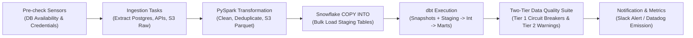

# Saudi eCommerce Data Platform

[](.github/workflows/ci.yml)
[](requirements.txt)
[](dags/saudi_ecommerce_dag.py)
[](src/processing/)
[](sql/ddl/snowflake_init.sql)
[](dbt/ecommerce_dbt/dbt_project.yml)
[](.github/workflows/ci.yml)

An enterprise-grade, cloud-native modern data platform designed and engineered to ingest, process, model, and serve high-throughput analytics for multi-channel eCommerce operations across the Kingdom of Saudi Arabia (Riyadh, Makkah/Jeddah, Eastern Province/Dammam, and regional distribution hubs).

---

## 📑 Table of Contents
* [🇸🇦 Business Context, Market Dynamics & SLAs](#-business-context-market-dynamics--slas)
* [🏗️ Architecture & End-to-End Data Flow](#️-architecture--end-to-end-data-flow)
* [💰 Domain Modeling & Financial Standards](#-domain-modeling--financial-standards)
* [🗄️ Data Lake & Storage Layout](#️-data-lake--storage-layout)
* [⚡ Processing & Lakehouse Ingestion Engine](#-processing--lakehouse-ingestion-engine)
* [🏛️ Dimensional Data Modeling (dbt)](#️-dimensional-data-modeling-dbt)
* [⏱️ Orchestration & Workflow DAGs (Apache Airflow)](#️-orchestration--workflow-dags-apache-airflow)
* [🛡️ Data Quality, Circuit Breakers & Observability](#️-data-quality-circuit-breakers--observability)
* [🔁 Backfill, Idempotency & Operations Runbook](#-backfill-idempotency--operations-runbook)
* [🚀 CI/CD & DevOps Engineering](#-cicd--devops-engineering)
* [📁 Repository Structure](#-repository-structure)
* [💻 Local Development & Getting Started](#-local-development--getting-started)
* [📐 Architecture Decision Records (ADRs) & Governance](#-architecture-decision-records-adrs--governance)
* [👥 Contributors & Maintainers](#-contributors--maintainers)

---

## 🇸🇦 Business Context, Market Dynamics & SLAs
Operating eCommerce in Saudi Arabia presents unique domain characteristics that directly shape our platform architecture:

1. **Payment Ecosystem Nuances**:
   * High adoption of **Mada** debit cards and **Apple Pay**.
   * Presence of **BNPL** providers (Tabby, Tamara) requiring multi-state reconciliation.
   * **Cash on Delivery (COD)** operational workflows: Order placement is decoupled from financial settlement; payments settle physically upon courier handover across multiple days, requiring separate order-state and cash-reconciliation tracking.
2. **Tax & Fiscal Regulations**:
   * Enforced **15% Value Added Tax (VAT)** across taxable goods and services.
   * Strict currency precision with zero tolerance for floating-point errors.
3. **Temporal & Seasonal Shopping Peaks**:
   * **Ramadan**: Drastic demand shifts with nocturnal shopping surges (10 PM to 4 AM).
   * **Eid al-Fitr & Eid al-Adha**: Massive pre-holiday fulfillment velocity.
   * **Saudi National Day (Sep 23) & Foundation Day (Feb 22)**: Intensive promotional spikes.
   * **White Friday**: High-concurrency checkout traffic.
4. **Logistics & Regional Topography**:
   * Urban centers (Riyadh, Jeddah, Dammam/Khobar) operate on tight same-day/next-day SLAs.
   * Last-mile logistics across Southern and Northern provinces rely on multi-tier third-party 3PL couriers with differing tracking webhook contracts.
5. **Service Level Agreements (SLAs)**:
   * **Execution Cadence & Freshness**: Daily batch pipelines run at `03:00 UTC` (`06:00 AST`) to deliver verified executive dashboards before local business hours.
   * **Data Integrity Gate**: Hard circuit breakers block downstream mart publication if critical financial or structural invariants fail.

---

## 🏗️ Architecture & End-to-End Data Flow
The platform implements a decoupled, modern Lakehouse architecture separating distributed compute from cloud storage and warehouse query processing:

```text
┌────────────────────────────────────────────────────────────────────────────────────────┐
│                                  DATA SOURCES LAYER                                    │
│  PostgreSQL (Transactional)  │  REST APIs (Payment/3PL)  │  Excel/CSV (Ops & Catalogs) │
└───────────────────────────────────────────┬────────────────────────────────────────────┘
                                            │ Python Ingestion (High-Watermark & Batch)
                                            v
┌────────────────────────────────────────────────────────────────────────────────────────┐
│                           RAW ZONE (AWS S3 OBJECT STORAGE)                             │
│   s3://saudi-ecom-data-lake/raw/{source}/{entity}/year=YYYY/month=MM/day=DD/           │
│   (Immutable, verbatim JSON/CSV/Avro extracts preserving source fidelity)              │
└───────────────────────────────────────────┬────────────────────────────────────────────┘
                                            │ PySpark Distributed Processing
                                            v
┌────────────────────────────────────────────────────────────────────────────────────────┐
│                        PROCESSED ZONE (AWS S3 OBJECT STORAGE)                          │
│   s3://saudi-ecom-data-lake/processed/{entity}/year=YYYY/month=MM/                     │
│   (Snappy-compressed columnar Parquet: Schema enforced, deduplicated, cleaned)         │
└───────────────────────────────────────────┬────────────────────────────────────────────┘
                                            │ Airflow-Orchestrated Snowflake External Stage
                                            v
┌────────────────────────────────────────────────────────────────────────────────────────┐
│                          SNOWFLAKE CLOUD DATA WAREHOUSE                                │
│   STAGING LAYER (COPY INTO RAW_STAGING)                                                │
│         │                                                                              │
│         v dbt Core Transformations (Incremental Models, Snapshots, Tests & Lineage)    │
│   CORE MARTS (Star Schema: Conformed Dimensions & Cumulative Fact Tables)              │
└───────────────────────────────────────────┬────────────────────────────────────────────┘
                                            │
                                            v
┌────────────────────────────────────────────────────────────────────────────────────────┐
│                             ANALYTICS & SERVING LAYER                                  │
│   Executive Dashboards (Power BI / Metabase / Streamlit) │ Ad-hoc SQL Analysis         │
└────────────────────────────────────────────────────────────────────────────────────────┘
```

### End-to-End Pipeline Lineage


---

## 💰 Domain Modeling & Financial Standards
All domain concepts adhere strictly to the ubiquitous vocabulary defined in [`GLOSSARY.md`](GLOSSARY.md). To prevent data corruption, rounding drift, and currency discrepancies, the platform enforces the following data contracts:

| Domain Rule | Standard | Implementation Rationale |
| :--- | :--- | :--- |
| **Currency Storage** | **Integer Halalas** | $1\text{ SAR} = 100\text{ Halalas}$. All monetary fields (`total_halalas`, `tax_halalas`, `discount_halalas`) are stored as 64-bit integers; float types are strictly prohibited in data models. |
| **Presentation Currency** | **Decimal SAR** | Decimal SAR values (`SAR 120.50`) are derived solely in dbt mart reporting views and presentation layers (`total_halalas / 100.0`). |
| **Tax Calculation** | **15% Saudi VAT** | Tax amounts are calculated and validated in integer arithmetic: `tax_halalas = round(net_amount_halalas * 0.15)`. |
| **Timezone Alignment** | **UTC Storage / AST Reporting** | All timestamps are captured, transferred, and stored in **UTC (ISO 8601)**. Reporting views convert to **Arabia Standard Time (AST, UTC+3)**. |
| **Geographic Standards** | **National Address Taxonomy** | Standardized regions: Riyadh, Makkah (Jeddah/Mecca), Eastern Province (Dammam/Khobar), Medina, Asir, etc., mapped to postal codes and `ISO-3166-2:SA`. |

---

## 🗄️ Data Lake & Storage Layout
Object keys in AWS S3 follow deterministic, partition-pruning paths across the `raw/` and `processed/` zones:

```text
s3://saudi-ecom-data-lake/
│
├── raw/                               # Immutable raw landing zone
│   ├── postgres/
│   │   ├── orders/year=2026/month=10/day=23/orders_20261023_040000.json.gz
│   │   ├── order_items/year=2026/month=10/day=23/order_items_...
│   │   └── customers/year=2026/month=10/day=23/customers_...
│   ├── payments_api/
│   │   └── transactions/year=2026/month=10/day=23/tx_...
│   └── operational/
│       ├── sales_targets_2026.xlsx
│       └── product_catalog_overrides.csv
│
└── processed/                         # Curated columnar Parquet
    ├── orders/year=2026/month=10/part-0000.c000.snappy.parquet
    ├── order_items/year=2026/month=10/...
    ├── customers/year=2026/month=10/...
    └── payments/year=2026/month=10/...
```

---

## ⚡ Processing & Lakehouse Ingestion Engine

### 1. Incremental High-Watermark Ingestion
* Transactional extractors query PostgreSQL using monotonically increasing timestamps:
```sql
SELECT * FROM source_orders 
WHERE updated_at >= :last_watermark_ts AND updated_at < :current_run_ts;
```
* Watermark states are durably tracked in an ingestion metadata audit store.

### 2. PySpark Cleaning & Normalization
* **Arabic Text Sanitization**: Normalizes Arabic Unicode strings (`أ/إ/آ` to `ا`, `ة` to `ه`, stripping Tatweel/Kashida) for customer names, addresses, and product categories.
* **Deduplication**: Handles late-arriving records by running windowed deduplication over primary keys ordered by `updated_at DESC`.
* **Columnar Optimization**: Writes Snappy-compressed Parquet partitioned by `year` and `month`, enforcing schema contracts.

### 3. Decoupled Snowflake Loading ([ADR-0001](docs/adr/0001-decoupled-s3-parquet-snowflake-copy.md))
* Rather than writing directly from PySpark to Snowflake over JDBC—which couples Spark and Snowflake failure domains, incurs high JDBC egress overhead, and prevents reloading historical partitions without re-running Spark compute—PySpark writes partitioned Parquet files to S3 and Snowflake loads them via an external stage:
```sql
COPY INTO raw_staging.stg_orders
FROM @raw_staging.s3_processed_stage/orders/
FILE_FORMAT = (TYPE = PARQUET)
MATCH_BY_COLUMN_NAME = CASE_INSENSITIVE
PURGE = FALSE;
```

---

## 🏛️ Dimensional Data Modeling (dbt)
The transformation layer organizes SQL models into `staging`, `intermediate`, and `marts` layers, modeling raw staging tables into an optimized dimensional Star Schema:

```text
                            ┌───────────────────┐
                            │   dim_customers   │
                            │  (SCD2 Snapshot)  │
                            └─────────┬─────────┘
                                      │
┌──────────────────┐        ┌─────────┴─────────┐        ┌──────────────────┐
│   dim_products   ├───────>│    fact_orders    │<───────┤   dim_locations  │
└──────────────────┘        └─────────┬─────────┘        └──────────────────┘
                                      │
                            ┌─────────┴─────────┐
                            │     dim_date      │
                            └───────────────────┘
```

### Dimensions
* **`dim_customers` ([ADR-0002](docs/adr/0002-scd2-dim-customers.md))**: Modeled as a **Slowly Changing Dimension Type 2 (SCD2)** using `dbt snapshot` with `valid_from`, `valid_to`, and `is_current` fields rather than overwriting attributes in place (SCD1). This preserves historical regional attribution when customers relocate across Saudi provinces (e.g., from Riyadh to Jeddah) or update phone verification and loyalty tiers.
* **`dim_products`**: Category hierarchy, brand, unit cost, and margin classifications.
* **`dim_locations`**: Saudi governorates, regional hubs, postal codes, and SLA delivery tiers.
* **`dim_date`**: Gregorian calendar annotated with Islamic/Hijri holiday flags (Ramadan, Eid al-Fitr, Eid al-Adha) and Saudi national holidays.

### Facts
* **`fact_orders` ([ADR-0003](docs/adr/0003-incremental-merge-lookback.md))**: Order header grain containing amounts in Halalas, discount codes, shipping fees, VAT amounts, and fulfillment lead times. Materialized using `incremental_strategy='merge'` keyed on `order_id` with a dynamic **7-day lookback window** (`updated_at >= dateadd(day, -7, current_date)`) to bound compute costs while idempotently updating late status transitions (`SHIPPED` to `DELIVERED`).
* **`fact_order_items`**: Line-item grain capturing quantity, unit price, SKU margins, and return statuses.
* **`fact_payments` ([ADR-0003](docs/adr/0003-incremental-merge-lookback.md))**: Multi-method settlement tracking (Mada, Apple Pay, BNPL, COD) capturing reconciliation status and gateway settlement latencies. Materialized via `incremental_strategy='merge'` keyed on `payment_id` with a **7-day lookback window** to reconcile multi-day COD cash collection upon courier delivery without full table refreshes or duplicate append rows.

---

## ⏱️ Orchestration & Workflow DAGs (Apache Airflow)
Apache Airflow schedules and supervises the end-to-end data pipeline:



* **Execution Cadence**: Runs daily at `03:00 UTC` (`06:00 AST`) to produce fresh reporting before business hours.
* **Fault Tolerance**: Upstream tasks are configured with 3 exponential-backoff retries for transient connection errors.
* **Failure Escalation**: Automated Slack webhooks dispatch execution context, run ID, and error logs directly to on-call data engineers.

---

## 🛡️ Data Quality, Circuit Breakers & Observability
We treat data quality as an architectural invariant enforced across four checkpoints, governed by a **Two-Tier Data Quality Policy ([ADR-0004](docs/adr/0004-two-tier-data-quality.md))**:

1. **Ingestion Contract Validation**: Pydantic models validate incoming API payloads and database schema definitions before raw persistence.
2. **PySpark Data Hygiene**: Quarantines malformed records failing primary key constraints, negative monetary values, or invalid region codes.
3. **Two-Tier dbt Test Assertions ([ADR-0004](docs/adr/0004-two-tier-data-quality.md))**:
   * **Tier 1 — Critical Hard Circuit Breakers**: Structural invariants that immediately **halt the Airflow DAG** before downstream marts are published, preventing corrupted executive dashboards or invalid regional financial totals:
     * `unique` and `not_null` assertions on all primary keys.
     * `relationships` tests enforcing referential integrity between fact foreign keys and dimension tables.
     * Non-negative Halala monetary invariants.
     * `accepted_values` validation on order statuses (`PENDING`, `CONFIRMED`, `SHIPPED`, `DELIVERED`, `CANCELLED`, `RETURNED`) and payment gateways (`MADA`, `APPLE_PAY`, `TABBY`, `TAMARA`, `COD`).
     * Custom SQL tests ensuring VAT amounts equal exactly 15% of net taxable totals within Halala rounding thresholds.
   * **Tier 2 — Warning Assertions**: SLA and operational variance checks that log warnings and emit metrics without blocking the pipeline or causing operational gridlock.
4. **Audit Trail**: Every pipeline run outputs structured JSON logs containing unique execution correlation IDs (`id_correlation`), records ingested, records transformed, and stage durations.

---

## 🔁 Backfill, Idempotency & Operations Runbook
All pipeline stages are engineered to be **idempotent and safe to retry**:

* **Storage Checkpoint Recovery ([ADR-0001](docs/adr/0001-decoupled-s3-parquet-snowflake-copy.md))**: Because PySpark outputs immutable, date-partitioned Snappy Parquet files into `s3://saudi-ecom-data-lake/processed/`, warehouse staging tables can be reloaded directly via Snowflake `COPY INTO` without re-running Spark compute.
* **Late-Arriving Mutations & Re-Runs ([ADR-0003](docs/adr/0003-incremental-merge-lookback.md))**: Re-running `dbt run` merges records over a sliding 7-day window (`updated_at >= dateadd(day, -7, current_date)`) keyed on `order_id` and `payment_id`, preventing duplicate fact rows while reconciling delayed courier settlements.
* **Historical Customer Attribution ([ADR-0002](docs/adr/0002-scd2-dim-customers.md))**: Fact joins against `dim_customers` filter on the snapshot validity window (`valid_from` / `valid_to`) so historical backfills preserve point-in-time regional attribution.

---

## 🚀 CI/CD & DevOps Engineering
All pipeline components undergo continuous automated validation via **GitHub Actions** (`.github/workflows/ci.yml` & `deploy.yml`):

* **Code Quality**: `ruff` for linting and formatting, and `mypy` for strict type annotations.
* **Unit & Spark Testing**: `pytest` testing Python extractors and PySpark transformations against local Spark mock contexts.
* **SQL Linting**: `sqlfluff` linting dbt SQL models against Snowflake dialect rules.
* **dbt Compilation**: `dbt compile --target test` validates DAG integrity and macro resolution.
* **Containerization & IaC**: Multi-stage `Dockerfile` and `docker-compose.yml` for reproducible execution environments, alongside Terraform configurations (`infra/`) for repeatable cloud resource provisioning.

---

## 📁 Repository Structure
```text
saudi-eCommerce-data-platform/
│
├── .github/
│   └── workflows/
│       ├── ci.yml                     # Automated lint, typecheck, and test runner
│       └── deploy.yml                 # Automated deployment to staging/production
│
├── dags/
│   ├── saudi_ecommerce_dag.py         # Main Airflow DAG orchestrating ETL lifecycle
│   └── utils/
│       ├── alerting.py                # Slack/Webhook alert handlers
│       └── sensors.py                 # Source availability sensors
│
├── src/
│   ├── ingestion/                     # Extractors (Postgres, Payment API, S3 landing)
│   │   ├── postgres_extractor.py      # Watermarked relational database extractor
│   │   ├── api_extractor.py           # Paginated REST API extractor
│   │   └── file_landing.py            # Excel/CSV operational file handler
│   │
│   ├── processing/                    # Distributed PySpark jobs
│   │   ├── clean_orders.py            # Deduplication & order schema transformation
│   │   ├── clean_customers.py         # Arabic string sanitization & customer enrichment
│   │   └── spark_session_factory.py   # Configured Spark session builder
│   │
│   ├── loading/                       # Snowflake warehouse loader
│   │   └── snowflake_loader.py        # External stage manager & COPY INTO executor
│   │
│   └── common/                        # Shared utilities
│       ├── config.py                  # Pydantic environment configuration
│       ├── logging.py                 # Structured JSON logger with correlation IDs
│       └── exceptions.py              # Classified platform exceptions
│
├── dbt/
│   └── ecommerce_dbt/
│       ├── dbt_project.yml            # dbt project definition
│       ├── profiles.yml.template      # Snowflake connection profiles template
│       ├── snapshots/                 # SCD Type 2 customer snapshots (ADR-0002)
│       ├── models/
│       │   ├── staging/               # Initial views over Snowflake raw staging
│       │   ├── intermediate/          # Business logic & deduplication merges
│       │   └── marts/                 # Dimensional star schema (facts & dimensions)
│       ├── tests/                     # Tier 1 & Tier 2 schema and VAT assertions (ADR-0004)
│       └── macros/                    # Halala-to-SAR converters, date utilities
│
├── infra/                             # Terraform Infrastructure as Code (S3, Snowflake, IAM)
│
├── sql/
│   ├── ddl/
│   │   ├── snowflake_init.sql         # Databases, schemas, warehouses, and RBAC
│   │   └── external_stages.sql        # S3 storage integrations & stage setup
│   └── analytics/
│       ├── kpi_regional_sales.sql     # Executive query: revenue by Saudi province
│       └── kpi_cod_reconciliation.sql # Executive query: COD collection SLA analysis
│
├── tests/
│   ├── unit/                          # Isolated unit tests for extractors and helpers
│   ├── spark/                         # PySpark transformation test suite
│   └── fixtures/                      # Mock data for localized tests
│
├── scripts/
│   └── setup_credentials_wizard.sh    # Interactive CLI wizard to configure AWS, Snowflake & Postgres
│
├── docs/
│   ├── adr/                           # Architecture Decision Records
│   │   ├── 0001-decoupled-s3-parquet-snowflake-copy.md
│   │   ├── 0002-scd2-dim-customers.md
│   │   ├── 0003-incremental-merge-lookback.md
│   │   └── 0004-two-tier-data-quality.md
│   └── agents/                        # Engineering skills & GitHub workflow configuration
│       ├── issue-tracker.md           # gh CLI issue & wayfinding conventions
│       ├── triage-labels.md           # Canonical issue triage role mappings
│       └── domain.md                  # Domain glossary & ADR consumption rules
│
├── GLOSSARY.md                        # Ubiquitous domain language dictionary
├── AGENTS.md                          # Repository instructions for AI pairing agents
├── Dockerfile                         # Production container image definition
├── docker-compose.yml                 # Local development services
├── requirements.txt                   # Production Python package requirements
├── requirements-dev.txt               # Development, testing, and linting dependencies
├── .env.example                       # Documented environment secrets template
└── README.md                          # Platform documentation
```

---

## 💻 Local Development & Getting Started

### 1. Prerequisites
* Docker Engine & Docker Compose (v2.20+)
* Python 3.11+
* Java 11 / 17 (required for local PySpark execution)
* AWS CLI & Snowflake Account credentials

### 2. Environment Setup
Clone the repository and initialize your local virtual environment:
```bash
# Clone the repository
git clone https://github.com/taha-shabaan/saudi-eCommerce-data-platform.git
cd saudi-eCommerce-data-platform

# Create and activate Python virtual environment
python3 -m venv venv
source venv/bin/activate

# Install dependencies
pip install -r requirements.txt
pip install -r requirements-dev.txt
```

### 3. Configure Secrets
Never commit passwords, API keys, or secrets to Git. Run the interactive setup wizard to configure your AWS, Snowflake, and PostgreSQL credentials securely:
```bash
./scripts/setup_credentials_wizard.sh
```
Alternatively, copy the template and populate your local credentials manually:
```bash
cp .env.example .env
```
Key configuration parameters:
* `ENV_STORAGE_BUCKET`: Target S3 bucket (`saudi-ecom-data-lake`)
* `AWS_DEFAULT_REGION`: `me-central-1` (Saudi Arabia) or `eu-west-1`
* `SNOWFLAKE_ACCOUNT`: Snowflake locator/identifier
* `SNOWFLAKE_WAREHOUSE`: Compute warehouse name
* `SNOWFLAKE_DATABASE`: Target analytics database

### 4. Running Services & Local Tests
Start local containerized services with Docker Compose and execute the automated validation suite:
```bash
# Start local development containers
docker compose up -d

# Run unit and PySpark tests
pytest tests/ -v

# Run Python linting
ruff check src/ tests/

# Validate dbt project compilation
cd dbt/ecommerce_dbt && dbt compile
```

---

## 📐 Architecture Decision Records (ADRs) & Governance

### Architecture Decision Log (`docs/adr/`)
All major architectural trade-offs are documented in `docs/adr/`:

| ADR | Decision Summary |
| :--- | :--- |
| **[ADR-0001](docs/adr/0001-decoupled-s3-parquet-snowflake-copy.md)** | **Decouple PySpark Processing from Snowflake Loading via S3 Parquet**: Write partitioned Snappy Parquet to the S3 Processed Zone and load Snowflake via `COPY INTO` rather than direct JDBC writes. |
| **[ADR-0002](docs/adr/0002-scd2-dim-customers.md)** | **Track Customer Profile Mutations with SCD Type 2 via dbt Snapshots**: Use `dbt snapshot` (`valid_from`, `valid_to`, `is_current`) on `dim_customers` to preserve historical regional attribution across Saudi provinces. |
| **[ADR-0003](docs/adr/0003-incremental-merge-lookback.md)** | **Idempotent Order Mutations via dbt Incremental Merge with Lookback Window**: Materialize `fact_orders` and `fact_payments` with `incremental_strategy='merge'` and a 7-day lookback window to handle multi-day COD settlement. |
| **[ADR-0004](docs/adr/0004-two-tier-data-quality.md)** | **Two-Tier Data Quality Policy with Hard Circuit Breakers**: Partition dbt quality tests into Tier 1 (Critical circuit breakers that halt the DAG on PK/FK/Halala/VAT violations) and Tier 2 (non-blocking SLA warnings). |

### Engineering & AI Agent Governance (`docs/agents/`)
* **Domain Vocabulary ([`docs/agents/domain.md`](docs/agents/domain.md))**: Contributors and AI agents must read `GLOSSARY.md` and relevant ADRs in `docs/adr/` before proposing changes, using canonical glossary terms and explicitly surfacing any ADR conflicts.
* **Issue Tracking & Wayfinding ([`docs/agents/issue-tracker.md`](docs/agents/issue-tracker.md))**: Issues and specs are managed as GitHub Issues via the `gh` CLI, supporting `wayfinder:map` parent issues, sub-issues, and native GitHub issue dependencies.
* **Triage Workflow ([`docs/agents/triage-labels.md`](docs/agents/triage-labels.md))**: Issues follow five canonical triage labels: `needs-triage`, `needs-info`, `ready-for-agent`, `ready-for-human`, and `wontfix`.

---

## 👥 Contributors & Maintainers
* **Lead Data Engineer**: Taha Shabaan ([@taha-shabaan](https://github.com/taha-shabaan))