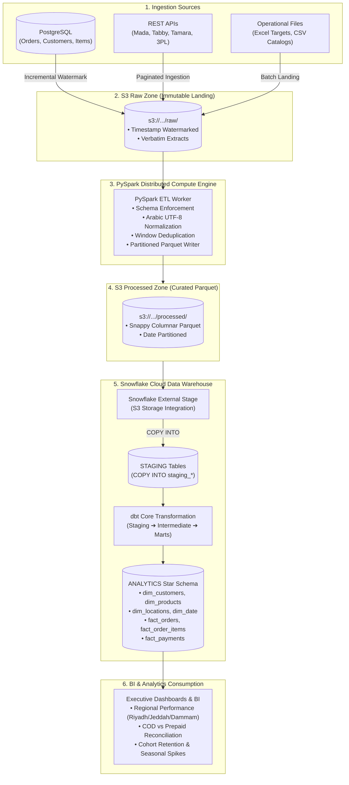
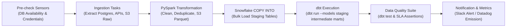

# Saudi eCommerce Data Platform

[](https://github.com/taha-shabaan/saudi-eCommerce-data-platform/actions)
[](LICENSE)
[](https://www.python.org/)
[](https://www.getdbt.com/)
[](https://www.snowflake.com/)
[](https://airflow.apache.org/)

An enterprise-grade, cloud-native modern data platform designed and engineered to ingest, process, model, and serve high-throughput analytics for multi-channel eCommerce operations across the Kingdom of Saudi Arabia (Riyadh, Makkah/Jeddah, Eastern Province/Dammam, and regional distribution hubs).

---

## 📑 Table of Contents

- [Business Context & Market Dynamics](#-business-context--market-dynamics)
- [Architecture & End-to-End Data Flow](#-architecture--end-to-end-data-flow)
- [Domain Modeling & Financial Standards](#-domain-modeling--financial-standards)
- [Data Lake & Storage Layout](#-data-lake--storage-layout)
- [Processing & Lakehouse Ingestion Engine](#-processing--lakehouse-ingestion-engine)
- [Dimensional Data Modeling (dbt)](#-dimensional-data-modeling-dbt)
- [Orchestration & Workflow DAGs (Apache Airflow)](#-orchestration--workflow-dags-apache-airflow)
- [CI/CD & DevOps Engineering](#-cicd--devops-engineering)
- [Repository Structure](#-repository-structure)
- [Local Development & Getting Started](#-local-development--getting-started)
- [Data Quality & Observability](#-data-quality--observability)

---

## 🇸🇦 Business Context & Market Dynamics

Operating eCommerce in Saudi Arabia presents unique domain characteristics that shape our data architecture:

1. **Payment Ecosystem Nuances**:
   - High adoption of **Mada** debit cards and **Apple Pay**.
   - Presence of **BNPL** providers (Tabby, Tamara) requiring multi-state reconciliation.
   - **Cash on Delivery (COD)** operational workflows: Order placement is decoupled from financial settlement; payments settle physically upon courier handover, requiring separate order-state and cash-reconciliation tracking.
2. **Tax & Fiscal Regulations**:
   - Enforced **15% Value Added Tax (VAT)** across taxable goods and services.
   - Strict currency precision: Zero tolerance for floating-point errors.
3. **Temporal & Seasonal Shopping Peaks**:
   - **Ramadan**: Drastic demand shifts with nocturnal shopping surges (10 PM to 4 AM).
   - **Eid al-Fitr & Eid al-Adha**: Massive pre-holiday fulfillment velocity.
   - **Saudi National Day (Sep 23) & Foundation Day (Feb 22)**: Intensive promotional spikes.
   - **White Friday**: High-concurrency checkout traffic.
4. **Logistics & Regional Topography**:
   - Urban centers (Riyadh, Jeddah, Dammam/Khobar) operate on tight same-day/next-day SLAs.
   - Last-mile logistics across Southern and Northern provinces rely on multi-tier third-party 3PL couriers with differing tracking webhook contracts.

---

## 🏗️ Architecture & End-to-End Data Flow

The platform implements a decoupled, modern Lakehouse architecture separating distributed compute from cloud storage and warehouse query processing:

```text
┌────────────────────────────────────────────────────────────────────────────────────────┐
│                                  DATA SOURCES LAYER                                    │
│  PostgreSQL (Transactional)  │  REST APIs (Payment/3PL)  │  Excel/CSV (Ops & Catalogs) │
└───────────────────────────────────────────┬────────────────────────────────────────────┘
                                            │ Python Ingestion (High-Watermark & Batch)
                                            v
┌────────────────────────────────────────────────────────────────────────────────────────┐
│                           RAW ZONE (AWS S3 OBJECT STORAGE)                             │
│   s3://saudi-ecom-data-lake/raw/{source}/{entity}/year=YYYY/month=MM/day=DD/           │
│   (Immutable, verbatim JSON/CSV/Avro extracts preserving source fidelity)              │
└───────────────────────────────────────────┬────────────────────────────────────────────┘
                                            │ PySpark Distributed Processing
                                            v
┌────────────────────────────────────────────────────────────────────────────────────────┐
│                        PROCESSED ZONE (AWS S3 OBJECT STORAGE)                          │
│   s3://saudi-ecom-data-lake/processed/{entity}/year=YYYY/month=MM/                     │
│   (Snappy-compressed columnar Parquet: Schema enforced, deduplicated, cleaned)         │
└───────────────────────────────────────────┬────────────────────────────────────────────┘
                                            │ Airflow-Orchestrated Snowflake External Stage
                                            v
┌────────────────────────────────────────────────────────────────────────────────────────┐
│                          SNOWFLAKE CLOUD DATA WAREHOUSE                                │
│   STAGING LAYER (COPY INTO RAW_STAGING)                                                │
│         │                                                                              │
│         v dbt Core Transformations (Incremental Models, Tests & Lineage)               │
│   CORE MARTS (Star Schema: Conformed Dimensions & Cumulative Fact Tables)              │
└───────────────────────────────────────────┬────────────────────────────────────────────┘
                                            │
                                            v
┌────────────────────────────────────────────────────────────────────────────────────────┐
│                             ANALYTICS & SERVING LAYER                                  │
│   Executive Dashboards (Power BI / Metabase / Streamlit) │ Ad-hoc SQL Analysis         │
└────────────────────────────────────────────────────────────────────────────────────────┘
```

### End-to-End Pipeline Lineage



---

## 💰 Domain Modeling & Financial Standards

To prevent data corruption, rounding drift, and currency discrepancies:

| Domain Rule | Standard | Implementation Rationale |
|---|---|---|
| **Currency Storage** | **Integer Halalas** | `1 SAR = 100 Halalas`. All monetary fields (`total_halalas`, `tax_halalas`, `discount_halalas`) are stored as 64-bit integers. Float types are strictly prohibited in data models. |
| **Presentation Currency** | **Decimal SAR** | Decimal SAR values (`SAR 120.50`) are derived solely in dbt mart reporting views and presentation layers (`total_halalas / 100.0`). |
| **Tax Calculation** | **15% Saudi VAT** | Tax amounts are calculated and validated in integer arithmetic: `tax_halalas = round(net_amount_halalas * 0.15)`. |
| **Timezone Alignment** | **UTC Storage / AST Reporting** | All timestamps are captured, transferred, and stored in **UTC (ISO 8601)**. Reporting views convert to **Arabia Standard Time (AST, UTC+3)**. |
| **Geographic Standards** | **National Address Taxonomy** | Standardized regions: `Riyadh`, `Makkah (Jeddah/Mecca)`, `Eastern Province (Dammam/Khobar)`, `Medina`, `Asir`, etc., mapped to postal codes and ISO-3166-2:SA. |

---

## 🗄️ Data Lake & Storage Layout

Object keys in S3 follow deterministic, partition-pruning paths:

```
s3://saudi-ecom-data-lake/
│
├── raw/                               # Immutable raw landing zone
│   ├── postgres/
│   │   ├── orders/year=2026/month=10/day=23/orders_20261023_040000.json.gz
│   │   ├── order_items/year=2026/month=10/day=23/order_items_...
│   │   └── customers/year=2026/month=10/day=23/customers_...
│   ├── payments_api/
│   │   └── transactions/year=2026/month=10/day=23/tx_...
│   └── operational/
│       ├── sales_targets_2026.xlsx
│       └── product_catalog_overrides.csv
│
└── processed/                         # Curated columnar Parquet
    ├── orders/year=2026/month=10/part-0000.c000.snappy.parquet
    ├── order_items/year=2026/month=10/...
    ├── customers/year=2026/month=10/...
    └── payments/year=2026/month=10/...
```

---

## ⚡ Processing & Lakehouse Ingestion Engine

### 1. Incremental High-Watermark Ingestion
- Transactional extractors query PostgreSQL using monotonically increasing timestamps:
  ```sql
  SELECT * FROM source_orders 
  WHERE updated_at >= :last_watermark_ts AND updated_at < :current_run_ts;
  ```
- Watermark states are durably tracked in an ingestion metadata audit store.

### 2. PySpark Cleaning & Normalization
- **Arabic Text Sanitization**: Normalizes Arabic Unicode strings (`أ/إ/آ` to `ا`, `ة` to `ه`, stripping Tatweel/Kashida) for customer names, addresses, and product categories.
- **Deduplication**: Handles late-arriving records by running windowed deduplication over primary keys ordered by `updated_at DESC`.
- **Columnar Optimization**: Writes Snappy-compressed Parquet partitioned by `year` and `month`, enforcing schema contracts.

### 3. Decoupled Snowflake Loading
- Decouples Spark compute from warehouse compute per [ADR-0001](docs/adr/0001-decoupled-s3-parquet-snowflake-copy.md).
- Snowflake external stage loads data efficiently using bulk `COPY INTO`:
  ```sql
  COPY INTO raw_staging.stg_orders
  FROM @raw_staging.s3_processed_stage/orders/
  FILE_FORMAT = (TYPE = PARQUET)
  MATCH_BY_COLUMN_NAME = CASE_INSENSITIVE
  PURGE = FALSE;
  ```

---

## 🏛️ Dimensional Data Modeling (dbt)

The transformation layer models raw staging tables into an optimized dimensional Star Schema:

```
                            ┌───────────────────┐
                            │   dim_customers   │
                            └─────────┬─────────┘
                                      │
┌──────────────────┐        ┌─────────┴─────────┐        ┌──────────────────┐
│   dim_products   ├───────>│    fact_orders    │<───────┤   dim_locations  │
└──────────────────┘        └─────────┬─────────┘        └──────────────────┘
                                      │
                            ┌─────────┴─────────┐
                            │     dim_date      │
                            └───────────────────┘
```

- **Dimensions**:
  - `dim_customers`: SCD Type 2 tracking customer profile updates, phone verification, and regional delivery preferences.
  - `dim_products`: Category hierarchy, brand, unit cost, and margin classifications.
  - `dim_locations`: Saudi governorates, regional hubs, postal codes, and SLA delivery tiers.
  - `dim_date`: Gregorian calendar annotated with Islamic/Hijri holiday flags (Ramadan, Eid al-Fitr, Eid al-Adha) and Saudi national holidays.
- **Facts**:
  - `fact_orders`: Order header grain containing amounts in Halalas, discount codes, shipping fees, VAT amounts, and fulfillment lead times.
  - `fact_order_items`: Line-item grain capturing quantity, unit price, SKU margins, and return statuses.
  - `fact_payments`: Multi-method settlement tracking (Mada, Apple Pay, BNPL, COD) capturing reconciliation status and gateway settlement latencies.

---

## ⏱️ Orchestration & Workflow DAGs (Apache Airflow)

Airflow schedules and supervises the end-to-end data pipeline:



- **Execution Cadence**: Runs daily at 03:00 UTC (06:00 AST) to produce fresh reporting before business hours.
- **Fault Tolerance**: Upstream tasks configured with 3 exponential-backoff retries for transient connection errors.
- **Failure Escalation**: Automated Slack webhooks dispatch execution context, run ID, and error logs directly to on-call data engineers.

---

## 🚀 CI/CD & DevOps Engineering

All pipeline components undergo continuous automated validation via **GitHub Actions**:

- **Code Quality**: `ruff` for linting and formatting, `mypy` for strict type annotations.
- **Unit Testing**: `pytest` testing Python extractors and PySpark transformations against local Spark mock contexts.
- **SQL Testing**: `sqlfluff` linting dbt SQL models against Snowflake dialect rules.
- **dbt Compilation**: `dbt compile --target test` validates DAG integrity and macro resolution.
- **Containerization**: Multi-stage Docker builds for lightweight, reproducible execution images across environments.

---

## 📁 Repository Structure

```
saudi-eCommerce-data-platform/
│
├── .github/
│   └── workflows/
│       ├── ci.yml                     # Automated lint, typecheck, and test runner
│       └── deploy.yml                 # Automated deployment to staging/production
│
├── dags/
│   ├── saudi_ecommerce_dag.py         # Main Airflow DAG orchestrating ETL lifecycle
│   └── utils/
│       ├── alerting.py                # Slack/Webhook alert handlers
│       └── sensors.py                 # Source availability sensors
│
├── src/
│   ├── ingestion/                     # Extractors (Postgres, Payment API, S3 landing)
│   │   ├── postgres_extractor.py      # Watermarked relational database extractor
│   │   ├── api_extractor.py           # Paginated REST API extractor
│   │   └── file_landing.py            # Excel/CSV operational file handler
│   │
│   ├── processing/                    # Distributed PySpark jobs
│   │   ├── clean_orders.py            # Deduplication & order schema transformation
│   │   ├── clean_customers.py         # Arabic string sanitization & customer enrichment
│   │   └── spark_session_factory.py   # Configured Spark session builder
│   │
│   ├── loading/                       # Snowflake warehouse loader
│   │   └── snowflake_loader.py        # External stage manager & COPY INTO executor
│   │
│   └── common/                        # Shared utilities
│       ├── config.py                  # Pydantic environment configuration
│       ├── logging.py                 # Structured JSON logger with correlation IDs
│       └── exceptions.py              # Classified platform exceptions
│
├── dbt/
│   └── ecommerce_dbt/
│       ├── dbt_project.yml            # dbt project definition
│       ├── profiles.yml.template      # Snowflake connection profiles template
│       ├── models/
│       │   ├── staging/               # Initial views over Snowflake raw staging
│       │   ├── intermediate/          # Business logic & deduplication merges
│       │   └── marts/                 # Dimensional star schema (facts & dimensions)
│       ├── tests/                     # Schema assertions & custom business logic tests
│       └── macros/                    # Halala-to-SAR converters, date utilities
│
├── sql/
│   ├── ddl/
│   │   ├── snowflake_init.sql         # Databases, schemas, warehouses, and RBAC
│   │   └── external_stages.sql        # S3 storage integrations & stage setup
│   └── analytics/
│       ├── kpi_regional_sales.sql     # Executive query: revenue by Saudi province
│       └── kpi_cod_reconciliation.sql # Executive query: COD collection SLA analysis
│
├── tests/
│   ├── unit/                          # Isolated unit tests for extractors and helpers
│   ├── spark/                         # PySpark transformation test suite
│   └── fixtures/                      # Mock data for localized tests
│
├── scripts/
│   └── setup_credentials_wizard.sh   # Interactive CLI wizard to configure AWS, Snowflake & Postgres
│
├── docs/
│   ├── adr/                           # Architecture Decision Records
│   │   └── 0001-decoupled-s3-parquet-snowflake-copy.md
│   └── agents/                        # Matt Pocock engineering skills configuration
│       ├── issue-tracker.md
│       ├── triage-labels.md
│       └── domain.md
│
├── GLOSSARY.md                        # Ubiquitous domain language dictionary
├── AGENTS.md                          # Repository instructions for AI pairing agents
├── Dockerfile                         # Production container image definition
├── docker-compose.yml                 # Local development services
├── requirements.txt                   # Production Python package requirements
├── requirements-dev.txt               # Development, testing, and linting dependencies
├── .env.example                       # Documented environment secrets template
└── README.md                          # Platform documentation
```

---

## 💻 Local Development & Getting Started

### 1. Prerequisites
- Docker Engine & Docker Compose (v2.20+)
- Python 3.11+
- Java 11 / 17 (required for local PySpark execution)
- AWS CLI & Snowflake Account credentials

### 2. Environment Setup
Clone the repository and initialize your local environment:
```bash
# Clone the repository
git clone https://github.com/taha-shabaan/saudi-eCommerce-data-platform.git
cd saudi-eCommerce-data-platform

# Create and activate Python virtual environment
python3 -m venv venv
source venv/bin/activate

# Install dependencies
pip install -r requirements.txt
pip install -r requirements-dev.txt
```

### 3. Configure Secrets
Run the interactive setup wizard to configure your AWS, Snowflake, and PostgreSQL credentials securely:
```bash
./scripts/setup_credentials_wizard.sh
```
Alternatively, copy the template and populate your local credentials manually:
```bash
cp .env.example .env
```
Key configuration parameters:
- `ENV_STORAGE_BUCKET`: Target S3 bucket (`saudi-ecom-data-lake`)
- `AWS_DEFAULT_REGION`: `me-central-1` (Saudi Arabia) or `eu-west-1`
- `SNOWFLAKE_ACCOUNT`: Snowflake locator/identifier
- `SNOWFLAKE_WAREHOUSE`: Compute warehouse name
- `SNOWFLAKE_DATABASE`: Target analytics database

### 4. Running Local Tests
Execute the automated test suite locally:
```bash
# Run unit and PySpark tests
pytest tests/ -v

# Run Python linting
ruff check src/ tests/

# Validate dbt project compilation
cd dbt/ecommerce_dbt && dbt compile
```

---

## 🛡️ Data Quality & Observability

We treat data quality as an architectural invariant, enforced at multiple checkpoints:

1. **Ingestion Contract Validation**: Pydantic models validate incoming API payloads and database schema definitions before raw persistence.
2. **PySpark Data Hygiene**: Quarantines malformed records failing primary key constraints, negative monetary values, or invalid region codes.
3. **dbt Test Assertions**:
   - `unique` and `not_null` assertions on all primary keys.
   - `relationships` tests enforcing referential integrity between fact foreign keys and dimension tables.
   - `accepted_values` validation on order statuses (`PENDING`, `CONFIRMED`, `SHIPPED`, `DELIVERED`, `CANCELLED`, `RETURNED`) and payment gateways (`MADA`, `APPLE_PAY`, `TABBY`, `TAMARA`, `COD`).
   - Custom SQL tests ensuring VAT amounts equal exactly 15% of net taxable totals within Halala rounding thresholds.
4. **Audit Trail**: Every pipeline run outputs structured JSON logs containing unique execution correlation IDs (`id_correlation`), records ingested, records transformed, and stage durations.

---

## 👥 Contributors & Maintainers
- **Lead Data Engineer**: Taha Shabaan ([@taha-shabaan](https://github.com/taha-shabaan))

### 1. Prerequisites
- Docker Engine & Docker Compose (v2.20+)
- Python 3.11+
- Java 11 / 17 (required for local PySpark execution)
- AWS CLI & Snowflake Account credentials

### 2. Environment Setup
Clone the repository and initialize your local environment:
```bash
# Clone the repository
git clone https://github.com/taha-shabaan/saudi-eCommerce-data-platform.git
cd saudi-eCommerce-data-platform

# Create and activate Python virtual environment
python3 -m venv venv
source venv/bin/activate

# Install dependencies
pip install -r requirements.txt
pip install -r requirements-dev.txt
```

### 3. Configure Secrets
Run the interactive setup wizard to configure your AWS, Snowflake, and PostgreSQL credentials securely:
```bash
./scripts/setup_credentials_wizard.sh
```
Alternatively, copy the template and populate your local credentials manually:
```bash
cp .env.example .env
```
Key configuration parameters:
- `ENV_STORAGE_BUCKET`: Target S3 bucket (`saudi-ecom-data-lake`)
- `AWS_DEFAULT_REGION`: `me-central-1` (Saudi Arabia) or `eu-west-1`
- `SNOWFLAKE_ACCOUNT`: Snowflake locator/identifier
- `SNOWFLAKE_WAREHOUSE`: Compute warehouse name
- `SNOWFLAKE_DATABASE`: Target analytics database

### 4. Running Local Tests
Execute the automated test suite locally:
```bash
# Run unit and PySpark tests
pytest tests/ -v

# Run Python linting
ruff check src/ tests/

# Validate dbt project compilation
cd dbt/ecommerce_dbt && dbt compile
```

---

## 🛡️ Data Quality & Observability

We treat data quality as an architectural invariant, enforced at multiple checkpoints:

1. **Ingestion Contract Validation**: Pydantic models validate incoming API payloads and database schema definitions before raw persistence.
2. **PySpark Data Hygiene**: Quarantines malformed records failing primary key constraints, negative monetary values, or invalid region codes.
3. **dbt Test Assertions**:
   - `unique` and `not_null` assertions on all primary keys.
   - `relationships` tests enforcing referential integrity between fact foreign keys and dimension tables.
   - `accepted_values` validation on order statuses (`PENDING`, `CONFIRMED`, `SHIPPED`, `DELIVERED`, `CANCELLED`, `RETURNED`) and payment gateways (`MADA`, `APPLE_PAY`, `TABBY`, `TAMARA`, `COD`).
   - Custom SQL tests ensuring VAT amounts equal exactly 15% of net taxable totals within Halala rounding thresholds.
4. **Audit Trail**: Every pipeline run outputs structured JSON logs containing unique execution correlation IDs (`id_correlation`), records ingested, records transformed, and stage durations.

---

## 👥 Contributors & Maintainers
- **Lead Data Engineer**: Taha Shabaan ([@taha-shabaan](https://github.com/taha-shabaan))

